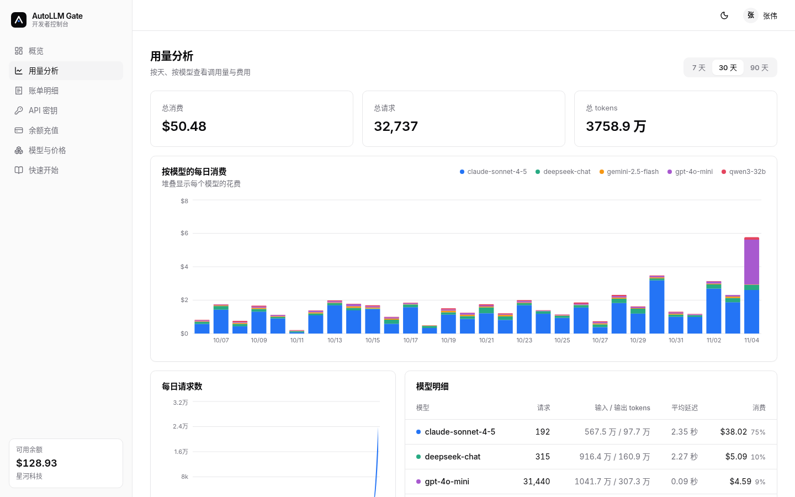
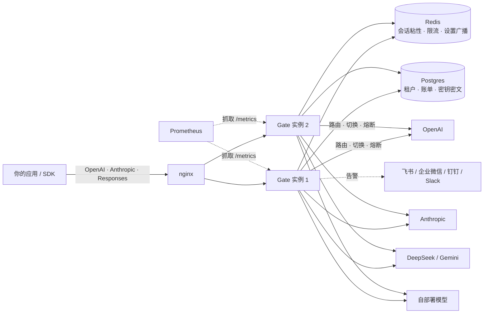
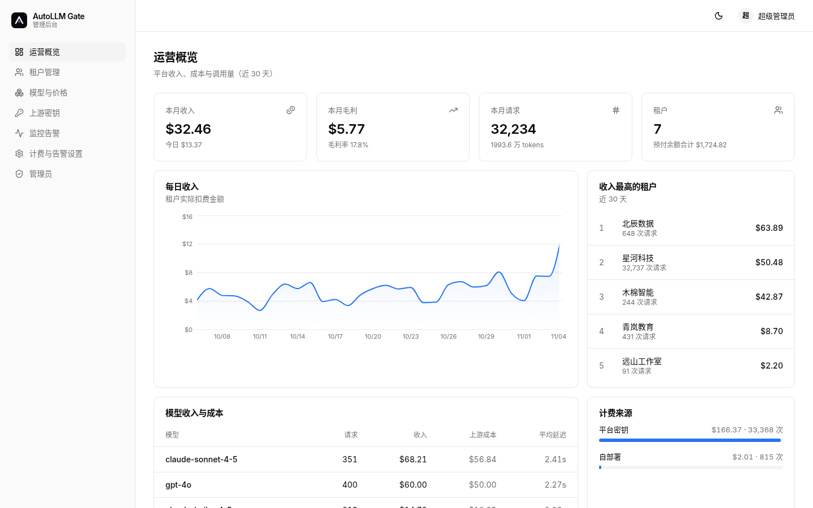
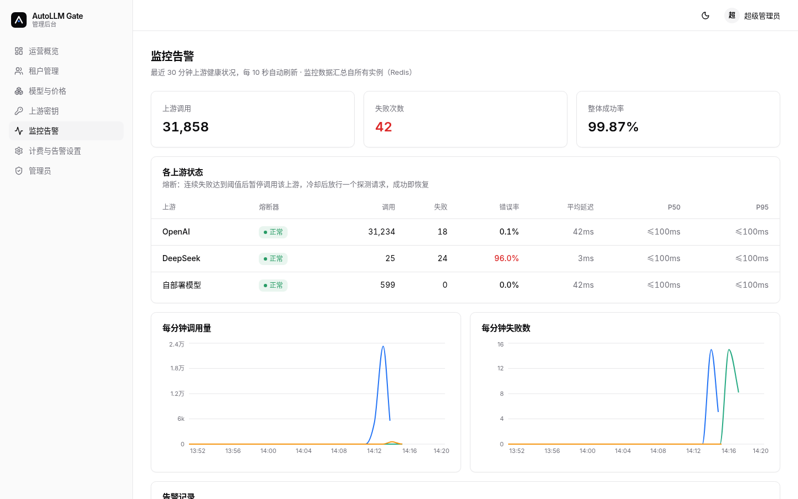
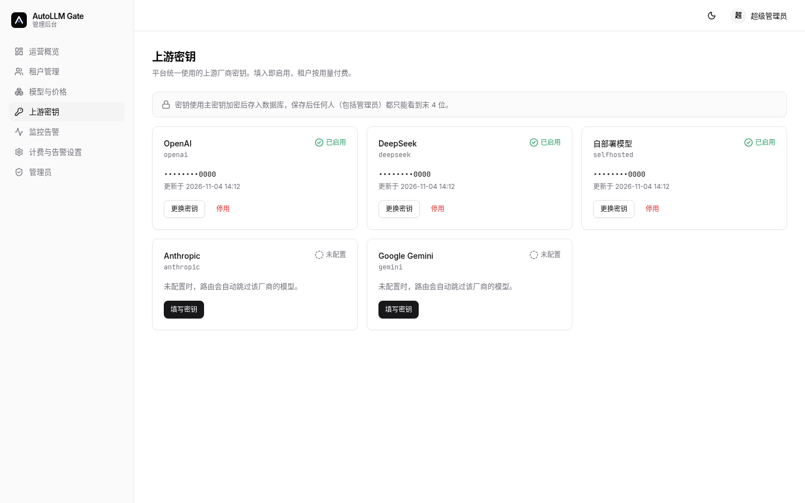
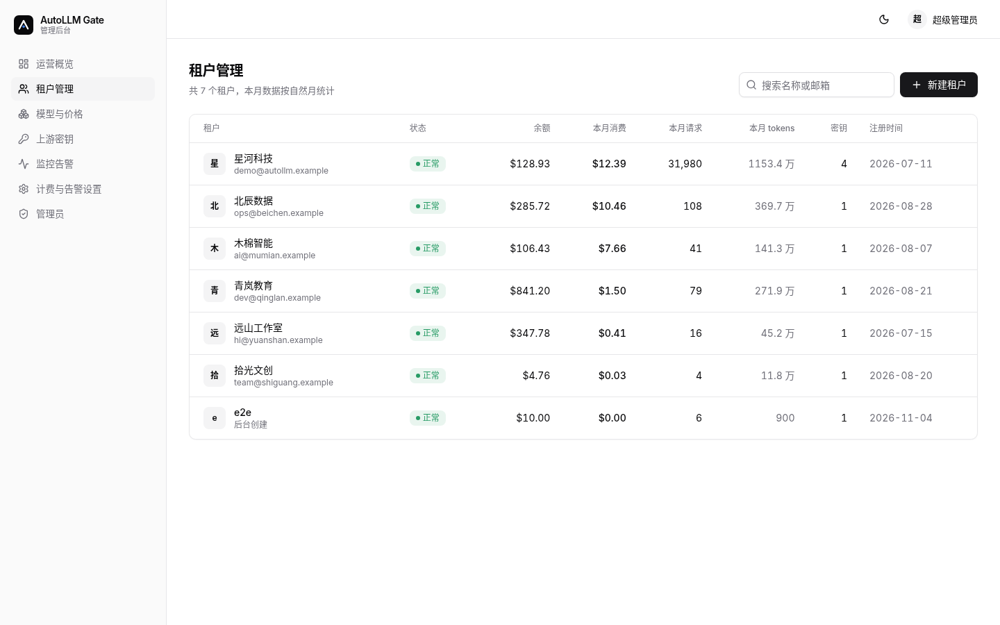
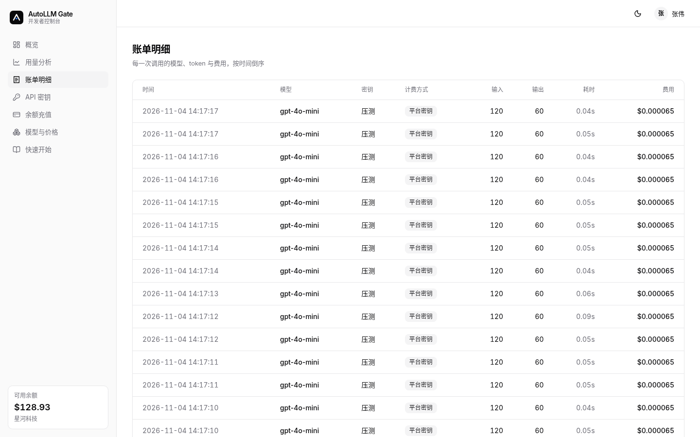
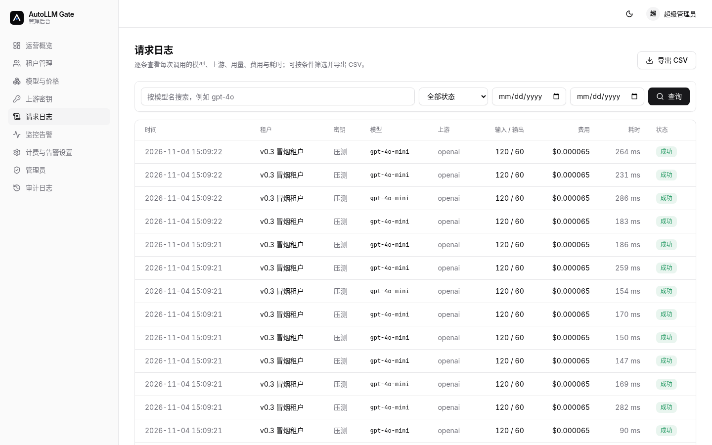
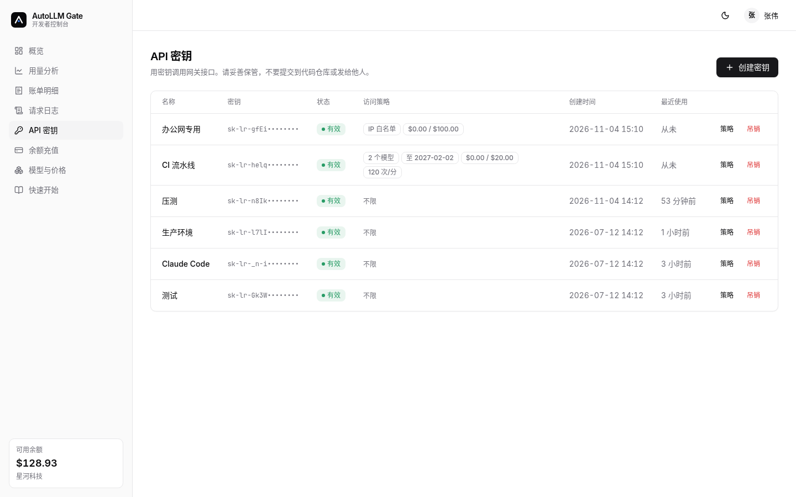
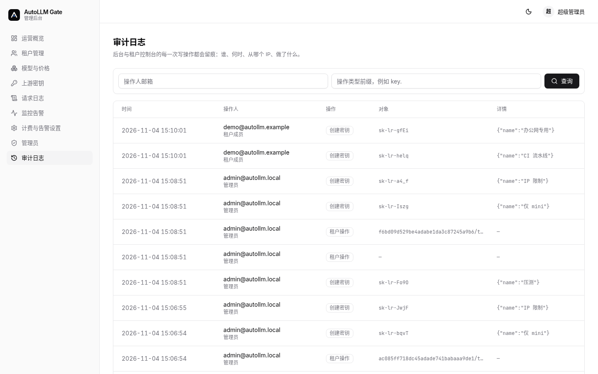

<p align="center">
  
</p>

<p align="center"><b>按量计费的商用大模型网关。</b>一个 API 地址接入多家模型，自动选模型、自动容灾，按实际用量向你的用户收费。</p>

<p align="center">
  
  
  
  
  
</p>

<p align="center">
  
</p>

## 它解决什么问题

团队要同时用 OpenAI、Anthropic、DeepSeek、Gemini 和自部署模型时，通常会遇到三件事：每家接口不一样；某家限流或故障时业务跟着出错；给内部团队或外部客户分账很麻烦。

AutoLLM Gate 放在你的应用和各家模型之间：

- **一个地址，三种协议。** 现有的 OpenAI SDK、Anthropic SDK、Responses 客户端改个 Base URL 就能用。
- **`model: "auto"`。** 按任务类型和成本挑模型；同一会话保持在同一个模型上。
- **出错自动换。** 上游 429、5xx、超时会切到下一个候选模型；连续失败的上游会被熔断，恢复后自动放回。
- **按量计费。** 每次请求先冻结额度、完成后按实际 tokens 结算，不会透支；平台加价、租户单独加价都能在后台改。

和直接调用各家 API 相比，差别在于：路由、容灾、计费、自助门户和运营后台是一套东西，部署后就能对外收费。

## 功能

| 模块 | 内容 |
|---|---|
| 网关 | `/v1/chat/completions`、`/v1/messages`、`/v1/responses`、`/v1/embeddings`，流式与非流式；自动路由；会话粘性（Redis 共享） |
| 稳定性 | 失败切换（429 / 5xx / 超时）、按上游熔断（多实例经 Redis 共享）、按 IP 与按密钥限流、`/healthz` `/readyz`、Prometheus `/metrics` |
| 计费 | 原子预扣与结算、平台与租户两级加价、自带密钥服务费，改动即时同步到所有实例 |
| 密钥策略 | 每个 API 密钥可单独设置模型白名单（支持前缀通配）、IP / CIDR 白名单、有效期、消费上限、每分钟请求数，修改即时生效 |
| 日志与审计 | 请求日志按租户 / 模型 / 状态 / 日期筛选、分页、导出 CSV；后台与控制台写操作自动记审计日志 |
| 开发者控制台 | 注册登录、概览、用量分析、账单明细、请求日志、API 密钥（含访问策略）、余额充值、模型价格、快速开始 |
| 运营后台 | 收入与成本概览、租户管理、模型与价格、上游密钥（加密存储、只显示掩码）、请求日志、监控告警、管理员、审计日志 |
| 告警 | 上游错误率突增、余额不足、月度额度将满；推送到飞书、企业微信、钉钉、Slack 或通用 Webhook |
| 安全 | argon2id 密码哈希、HttpOnly 签名 Cookie + CSRF 校验、Webhook 防 SSRF、生产模式启动检查；Webhook 直连已校验的 IP，防 DNS 重绑定 |
| 插件化核心 | 路由与计价通过插件接口加载，公开仓库自带可运行的默认实现 |

## 实测数据

以下数据来自 [验收记录](docs/ACCEPTANCE.md)。**上游是本地假上游（约 40ms 固定延迟），不代表真实模型的延迟**，测的是网关本身的吞吐和容灾能力。环境：单机 Docker，2 个网关实例 + nginx + Postgres 16 + Redis 7。

| 场景 | 结果 |
|---|---|
| 并发 50，持续 60 秒 | 23,496 次请求，390.7 RPS，p50 109ms，p95 236ms，错误率 0% |
| v0.3 回归：并发 50，持续 30 秒（每次请求都经过密钥策略检查） | 9,175 次请求，304.3 RPS，p50 144ms，p95 324ms，错误率 0%；结束后冻结额为 0，无负余额 |
| 运行中停掉一家上游 30 秒（20 RPS） | 1,379 次请求 0 失败；0.15 秒开始切换，0.71 秒熔断生效，恢复后 0.43 秒流量回切 |

## 架构



## 快速开始（本地一键体验）

支持 Mac（Apple 芯片 / Intel）、Windows 和 Linux，镜像同时提供 amd64 与 arm64。先安装并打开 [Docker Desktop](https://www.docker.com/products/docker-desktop/)，然后在终端里：

```bash
mkdir autollm && cd autollm
curl -fsSLO https://raw.githubusercontent.com/Chenfyuan/autollm-gate/main/docker-compose.quickstart.yml
curl -fsSLO https://raw.githubusercontent.com/Chenfyuan/autollm-gate/main/quickstart.env.example
curl -fsSL  https://raw.githubusercontent.com/Chenfyuan/autollm-gate/main/scripts/gen-env.sh -o gen-env.sh
curl -fsSL  https://raw.githubusercontent.com/Chenfyuan/autollm-gate/main/scripts/quickstart-demo.sh -o quickstart-demo.sh
sh gen-env.sh                                              # 生成 .env（随机密钥），并打印管理员账号密码
docker compose -f docker-compose.quickstart.yml up -d      # 拉镜像、启动，数据库自动迁移
sh quickstart-demo.sh                                      # 可选：用假上游发一次测试请求，不花钱
```

- 运营后台：<http://localhost:8080/admin>（用 `gen-env.sh` 打印的管理员账号登录）
- 客户控制台：<http://localhost:8080/console>
- 健康检查：<http://localhost:8080/healthz>

停止 `docker compose -f docker-compose.quickstart.yml down`；升级 `... pull && ... up -d`；清空数据 `... down -v`。

**手把手的图文步骤、真实 Key 接入、常见问题（端口冲突、Apple 芯片、数据位置）以及甲骨文云新加坡 ARM 服务器部署（只开 80/443、SSH 密钥、HTTPS），见 [部署与配置详解](docs/DEPLOYMENT.md)。**

镜像：`ghcr.io/chenfyuan/autollm-gate-gateway`（`latest` / `sha-<提交号>` / 版本号），一个镜像包含网关、运营后台与客户控制台。本地构建：`docker compose -f docker-compose.quickstart.yml build`；多架构构建：`docker buildx bake`。

调用示例（把 Base URL 换成你的网关地址）：

```python
from openai import OpenAI
client = OpenAI(base_url="http://localhost:8080/v1", api_key="<后台或控制台创建的密钥>")
resp = client.chat.completions.create(model="auto", messages=[{"role": "user", "content": "你好"}])
```

## 部署形态（源码部署）

```bash
git clone https://github.com/Chenfyuan/autollm-gate.git && cd autollm-gate
cp .env.example .env        # 按注释填写主密钥、会话密钥、数据库密码、首个管理员
docker compose up -d --build
```

在 `.env` 里用 `COMPOSE_PROFILES` 选择：

| 形态 | 包含 |
|---|---|
| `single` | 1 个网关 + Postgres + Redis，适合试用 |
| `ha` | 2 个网关 + nginx 负载均衡，共享 Postgres 与 Redis |
| `ha,monitoring` | 在 ha 基础上加 Prometheus 与预置告警规则 |

## 界面

| 运营概览 | 监控告警 |
|---|---|
|  |  |
| **上游密钥** | **租户管理** |
|  |  |
| **账单明细** | **请求日志** |
|  |  |
| **密钥访问策略** | **审计日志** |
|  |  |

截图中的租户、金额均为演示数据。

## 路线图与已知差距

已完成（v0.2）：三协议网关、自动路由与失败切换、熔断、限流、原子计费、开发者控制台、运营后台、监控告警、高可用部署。

已完成（v0.3）：密钥级访问策略、请求日志检索与导出、审计日志、`/v1/embeddings`、多实例共享熔断、Webhook 防 DNS 重绑定、核心逻辑插件化。与主流平台的逐项对比见 [竞品对比与规划](docs/COMPETITIVE.md)。

规划中：

- 真实支付渠道（微信支付 / 支付宝 / Stripe）——目前为占位，尚不可用
- 接入真实模型的端到端测试——目前只在假上游上验证
- 同一上游多密钥加权负载均衡、渠道健康检查与自动禁用
- TPM 限流、响应缓存、护栏（PII 脱敏 / 注入检测）、请求正文记录与会话追踪
- 团队成员与角色权限、SSO
- 图像 / 音频接口；Azure OpenAI、Bedrock 等更多上游
- Postgres / Redis / nginx 冗余与内置 TLS（目前为单点，需自行在前面加 TLS）
- 监控页 p50/p95 改为精确值（目前为直方图近似）

## 常见问题

**现有代码要改多少？** 一般只改 Base URL 和 API Key。模型名可以写具体模型，也可以写 `auto`。

**某家模型挂了会怎样？** 请求会切到下一个候选模型；该上游连续失败后被熔断跳过，恢复后自动放回。参数错误（4xx）不会切换，直接返回给调用方。

**能不能用自己的模型密钥？** 可以。平台统一密钥和租户自带密钥都支持，自带密钥可单独设服务费。

**密钥安全吗？** 上游密钥用主密钥加密后存库，界面和接口只显示末 4 位；租户 API 密钥只在创建时显示一次。

**现在能直接收钱吗？** 还不能。计费、余额、账单已完成，但真实支付渠道仍在规划中。

## 开发

```bash
pip install -r requirements-dev.lock && pip install -e .
pytest
cd web && npm ci && npm run build
cd site && npm ci && npm run build   # 官网，产物在 site/dist
```

## 许可

源码可查看，但**不是开源软件**。版权所有（All rights reserved），未经书面许可，不得使用、复制、修改或分发。详见 [LICENSE](LICENSE)。

## 商务联系

预约演示、托管服务开通与企业版咨询：chenfyuanl [at] gmail.com。价格见 [官网](https://chenfyuan.github.io/autollm-gate/#pricing) 与 [docs/PRICING.md](docs/PRICING.md)。问题反馈请提 GitHub Issues。
